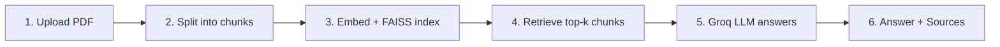
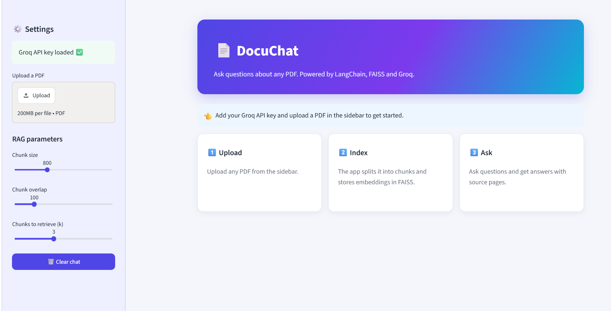
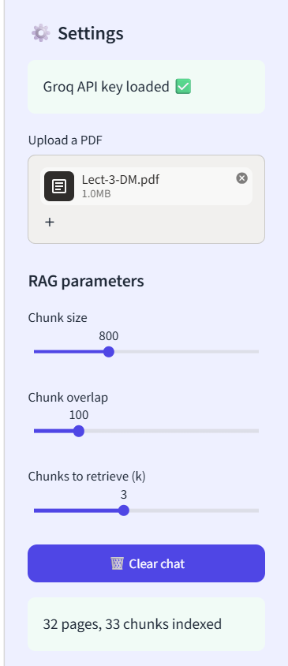
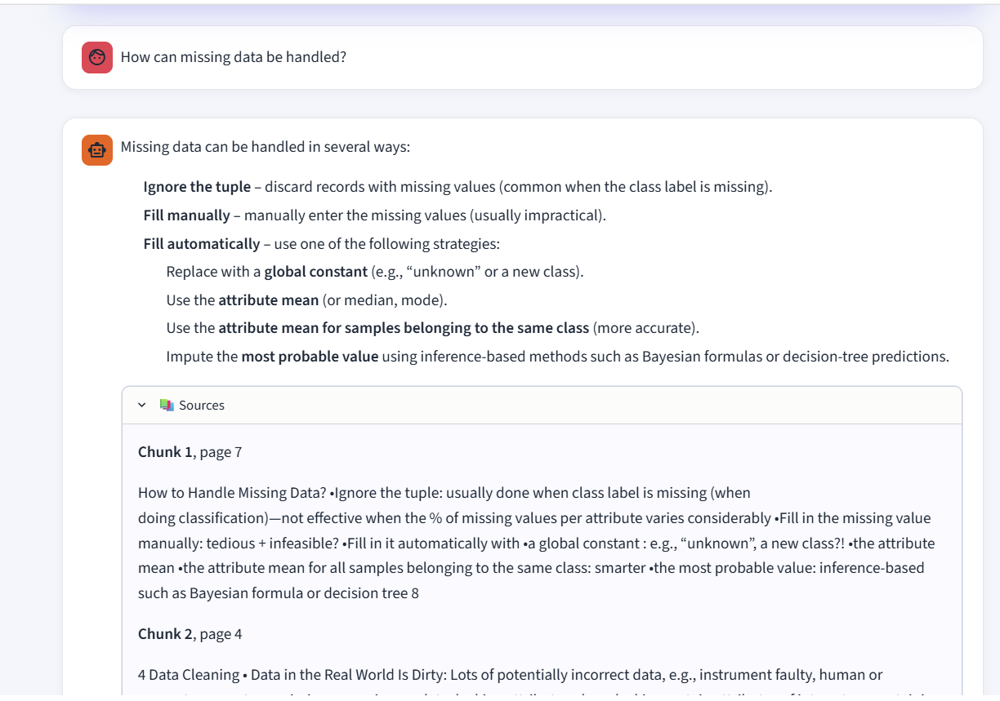
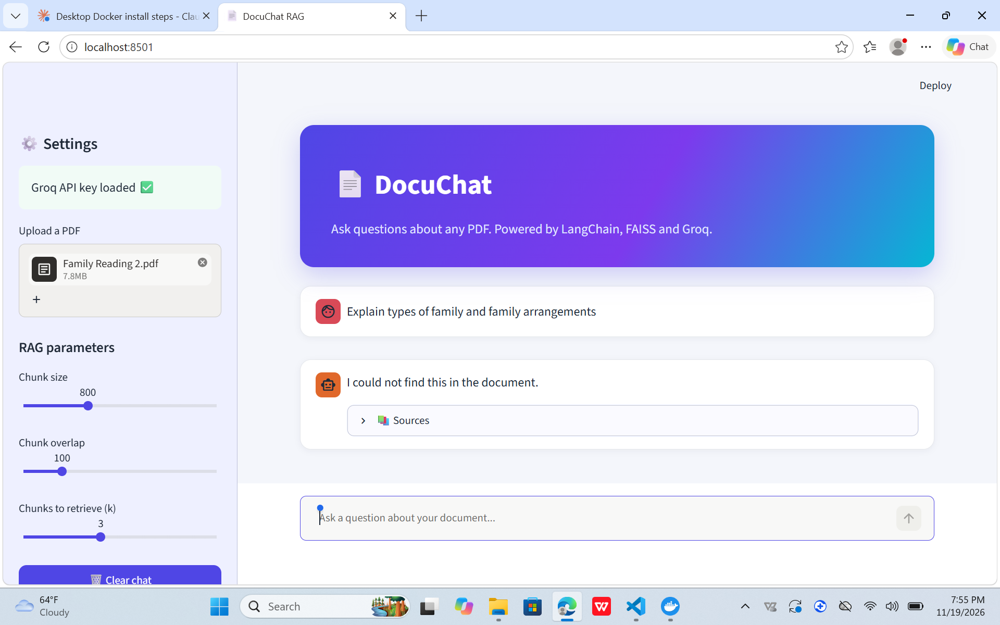
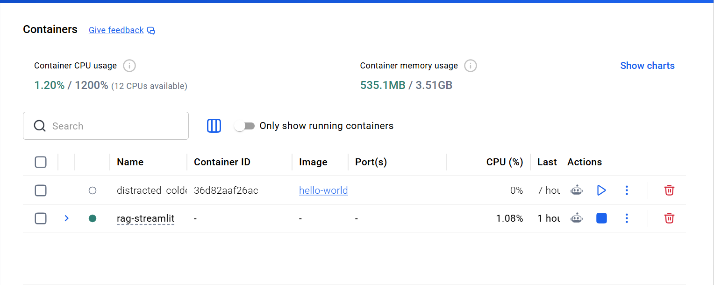

<div align="center">

# 📄 DocuChat RAG

### Ask questions about any PDF, and get answers grounded in the document


**[Features](#-features) • [How it works](#-how-it-works) • [Quick start](#-quick-start) • [Docker](#-run-with-docker) • [Tuning](#%EF%B8%8F-rag-parameters) • [Troubleshooting](#-troubleshooting) • [Roadmap](#-roadmap)**

</div>

---

## 💡 What is DocuChat?

**DocuChat** is a Retrieval-Augmented Generation (RAG) web app. Upload a PDF, ask questions in plain language, and get answers built **only from passages found in your document**. If the PDF doesn't contain the answer, DocuChat says so instead of making something up.

> **In one sentence:** DocuChat turns any PDF into a chat partner that answers from the document and shows the exact sources it used.

## ✨ Features

- 💬 **Chat interface** for question answering over PDF files
- 🎯 **Grounded answers**: reduces hallucination by answering only from retrieved context
- 🔎 **Source transparency**: every answer comes with an expandable **Sources** section
- 🎛️ **Tunable retrieval**: change chunk size, overlap and number of chunks from the sidebar
- 🚫 **Honest refusals**: replies *"I could not find this in the document."* when the answer isn't there
- 🐳 **Docker support** for repeatable deployment on any machine

## 🧠 How it works



<details>
<summary><b>Click for the step-by-step explanation</b></summary>

<br>

| Step | What happens |
|------|--------------|
| **1. Upload** | The user uploads a PDF from the sidebar. |
| **2. Split** | Text is extracted and cut into overlapping chunks. |
| **3. Embed and index** | Each chunk is converted into a vector and stored in a FAISS index. |
| **4. Retrieve** | For every question, the *k* most similar chunks are found. |
| **5. Generate** | The question and chunks are sent to the Groq model, which answers using only that context. |
| **6. Display** | The answer appears in the chat with an expandable **Sources** section. |

</details>

## 🧰 Tech stack

| Layer | Technology | Role |
|-------|------------|------|
| Interface | **Streamlit** | Web UI, chat window, sidebar controls |
| Orchestration | **LangChain** | Loads the PDF, splits text, builds the question-answer chain |
| Vector search | **FAISS** | Stores chunk embeddings and finds the most similar ones |
| Language model | **Groq API** | Generates the final answer from retrieved context |
| Packaging | **Docker / Compose** | Runs the app in a consistent container |
| Language | **Python** | All application code |

## 📁 Project structure

```text
docuchat-rag/
├── app.py               # Streamlit app (UI + RAG logic)
├── requirements.txt     # Python dependencies
├── Dockerfile           # Container image definition
├── docker-compose.yml   # Container run configuration
├── .env.example         # Template for your API key
├── .dockerignore        # Files excluded from the Docker build
└── .gitignore           # Files excluded from version control
```

## 🚀 Quick start

### Prerequisites

- Python **3.10** or newer
- A free **Groq API key** from [console.groq.com](https://console.groq.com)

### 1. Clone the repository

```bash
git clone https://github.com/engineer-sidra-iftikhar/docuchat-rag.git
cd docuchat-rag
```

### 2. Choose your setup

<details open>
<summary><b>🪟 Windows (PowerShell)</b></summary>

```powershell
python -m venv .venv
Set-ExecutionPolicy -Scope Process RemoteSigned
.\.venv\Scripts\Activate.ps1
pip install -r requirements.txt
```

</details>

<details>
<summary><b>🐧 macOS / Linux / Git Bash</b></summary>

```bash
python -m venv .venv
source .venv/bin/activate        # Git Bash on Windows: source .venv/Scripts/activate
pip install -r requirements.txt
```

</details>

### 3. Add your API key

Copy the template and put your real key in it:

```bash
cp .env.example .env
```

```env
GROQ_API_KEY=your_key_here
```

> ⚠️ **Never commit your `.env` file.** It is already listed in `.gitignore`.

### 4. Run the app

```bash
streamlit run app.py
```

Open **http://localhost:8501** in your browser. 🎉

## 🐳 Run with Docker

With Docker Desktop running, no manual package installation is needed:

```bash
# Build the image and start the container
docker compose up --build

# Run in the background
docker compose up -d

# Stop and remove the container
docker compose down
```

Then open **http://localhost:8501**.

## 🖱️ Using the app

1. **Check the sidebar**: it confirms that your Groq API key is loaded.
2. **Upload a PDF**: the file is processed and indexed automatically.
3. **Ask a question** in the chat box at the bottom.
4. **Expand "Sources"** under any answer to see the exact chunks that were used.
5. Use **Clear chat** in the sidebar to reset the conversation.

<p align="center">
  
  
</p>
<p align="center">
  
  
</p>
<p align="center">
  
</p>

## 🎛️ RAG parameters

The sidebar exposes three settings. These are the values used during testing:

| Parameter | Value used | What it controls |
|-----------|:----------:|------------------|
| **Chunk size** | `800` | Length of each chunk. Bigger = more context, less precision. |
| **Chunk overlap** | `100` | Text shared between neighbouring chunks so ideas aren't cut in half. |
| **Chunks to retrieve (k)** | `3` | How many chunks are sent to the model per question. |

> 💡 **Tuning tip:** For broad questions spread over many pages, increase **k** (for example to 5 or 6) or use larger chunks. For very specific questions, smaller chunks give more precise matches.

## 📊 Results and observations

- ✅ Processes a large (7.8 MB) PDF and answers from its content
- ✅ Answers are grounded, and the Sources panel makes them verifiable
- ✅ Refuses instead of guessing when the retrieved chunks lack the answer
- ℹ️ Broad, multi-page questions (e.g. *"Explain types of family and family arrangements"*) returned the not-found message with chunk size 800 and k = 3, so they need a higher **k** or larger chunks
- ✅ Docker makes the setup identical on any machine

## 🛠️ Troubleshooting

<details>
<summary><b>PowerShell refuses to activate <code>.venv</code></b></summary>

**Cause:** script execution is blocked.
**Fix:**
```powershell
Set-ExecutionPolicy -Scope Process RemoteSigned
```
Then activate again.

</details>

<details>
<summary><b>"API key not loaded" message</b></summary>

**Cause:** `.env` is missing or the key name is wrong.
**Fix:** make sure `.env` contains `GROQ_API_KEY=...`, then restart the app.

</details>

<details>
<summary><b>"I could not find this in the document" for a valid topic</b></summary>

**Cause:** retrieved chunks are too few or too small.
**Fix:** increase **k** or chunk size, or ask a more specific question.

</details>

<details>
<summary><b>Port 8501 already in use</b></summary>

**Cause:** another Streamlit app is running.
**Fix:** stop it, or use another port:
```bash
streamlit run app.py --server.port 8502
```

</details>

<details>
<summary><b>Docker command fails</b></summary>

**Cause:** Docker Desktop is not running.
**Fix:** start Docker Desktop, wait until it shows *running*, then retry.

</details>

## ⚠️ Limitations

- Scanned PDFs (images without selectable text) need OCR, which is not included
- Only one PDF can be used at a time
- Answer quality depends on which chunks are retrieved
- A Groq API key and an internet connection are required

## 🗺️ Roadmap

- [ ] Support several PDFs and other formats (DOCX, TXT) to search a whole library
- [ ] Add OCR so scanned files become searchable
- [ ] Add chat memory for natural follow-up questions
- [ ] Deploy online and share through a public link

## 📚 References

- [Streamlit documentation](https://docs.streamlit.io)
- [LangChain documentation](https://python.langchain.com)
- [FAISS](https://github.com/facebookresearch/faiss)
- [Groq documentation](https://console.groq.com/docs)
- [Docker documentation](https://docs.docker.com)

---

<div align="center">

Built with ❤️ using Streamlit, LangChain, FAISS and Groq

⭐ If you find this project useful, consider giving it a star!

</div>
